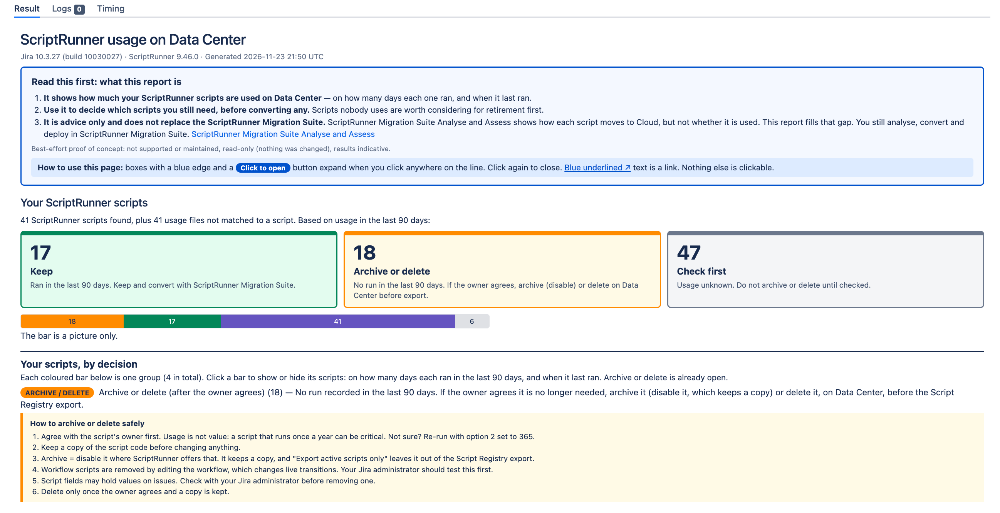

# ScriptRunner for Jira: Data Center usage report

> **Best-effort proof of concept.** Not supported, not maintained, not an official Adaptavist or Atlassian tool. Read-only for Jira. Writes one file (the saved report, see below). No network calls. Results are indicative: verify before acting.

> **The point:** see which ScriptRunner scripts ran recently on Data Center, so you and each script's owner can make an informed decision about what to archive before converting with the [ScriptRunner Migration Suite](https://docs.adaptavist.com/sms/latest). The report shows data; you decide.

> **For a real analysis of your instance, use the [ScriptRunner Migration Suite](https://docs.adaptavist.com/sms/latest).** Its Analyse and Assess tool shows how each script moves to Cloud; its Migration Agent converts them. It doesn't show which scripts are actually used. That's the gap this report fills, so you don't convert scripts nobody needs.

## What it shows

For each ScriptRunner script on Data Center:

- whether it ran in the last N days (default 90)
- roughly when it last ran (UTC date), taken from the last-changed date of ScriptRunner's own usage file

It never opens ScriptRunner's usage files, so it can't get in the way of ScriptRunner writing them. It shows usage only. It never says whether a script can move to Cloud.

## Where it fits

1. Run this report and review the "No run in last N days, archive candidate" list with script owners.
2. If you decide a script is no longer needed, disable it (archive). Delete only later, once nothing broke while it was disabled.
3. Script Registry export ("Export active scripts only").
4. [ScriptRunner Migration Suite Analyse and Assess](https://docs.adaptavist.com/sms/latest/scriptrunner-migration-suite-web-app/scriptrunner-migration-analyse-and-assess-tool) (always do this).
5. Convert with the [ScriptRunner Migration Suite Migration Agent](https://docs.adaptavist.com/sms/latest/scriptrunner-migration-suite-web-app/scriptrunner-migration-agent), deploy with the [Dev and Deployment Tool](https://docs.adaptavist.com/sms/latest/scriptrunner-dev-and-deployment-tool).

Best used before the Script Registry export. Already ran Analyse and Assess? Use both together, then export and analyse again after retiring scripts.

## Before you start

- Jira Data Center with ScriptRunner for Jira installed.
- A Jira administrator who can open the ScriptRunner **Script Console**.
- Tested on Jira 10.3 with ScriptRunner 9.x, on a single node and on a large multi-node production cluster (see [Benchmark](#benchmark)). Other versions may work but are untested.
- Try it on a non-production instance first if you can.

**Is it safe?** It changes no Jira data or configuration and makes no network calls. It writes one file: the finished report, saved to `$JIRA_HOME/scriptrunner/migration-readiness/last-report.html` and overwritten on each run. The file lists script, workflow and project names, and gets the Jira home folder's normal file permissions. Nothing else is written.

### On a cluster (multi-node)

Run it once, from any node. You don't need to run it on each node.
The report reads every node's usage files from the shared home and combines them.
Check the "Nodes read" line (under "How this data was collected") matches Jira admin → System → Clustering.
If a node is missing, nothing is marked unused and the report tells you which node.
Tip: run it on one node's own address rather than through the load balancer, so a second click can't start a run on another node.

## How to run

1. Jira admin → ScriptRunner → **Console**. On a cluster, open Jira on one node's own address (not through the load balancer).
2. Paste the whole of [`migration-readiness.groovy`](migration-readiness.groovy). Wait until "Checking script" finishes: the options form appears above the script. The console may underline lines or show type-checking messages: these are cosmetic, ignore them.
3. Set option 1 (see below), leave the rest blank, and click **Run** once. Off-peak if you can.
4. Read the HTML report under the console. Start with "Read this first".

**How long to allow (option 1):** small instances, leave blank (50 s). Large or multi-node instances, use **600**.

**Getting the report file** (to share or keep), either:
- copy `$JIRA_HOME/scriptrunner/migration-readiness/last-report.html` from the shared home, or
- type `yes` in option 4, click Run, and save the page from your browser (Ctrl+S or Cmd+S).

It lists your script names, so share it securely and delete copies when done.

### Form options

| # | Option | Default | What it does |
|---|---|---|---|
| 1 | Maximum run time (seconds) | 50 | Browsers and proxies often give up after about 60 s. At this limit the report stops listing and marks anything not covered as "Not read". Up to 1200, set here only (no change inside the script). On large instances, use 600, off-peak, on one node's own address (not through the load balancer). |
| 2 | Window (days) | 90 | Scripts with no run in this many days are listed as "No run in last N days, archive candidate". Widen it (e.g. 365) to catch quarterly or yearly scripts. |
| 3 | Script Listener names | blank | Usually not needed: since 2.2.0 listeners are named automatically. Only use it if the report says ScriptRunner's own script list couldn't be read. Format: `uuid=Name; uuid=Name`. |
| 4 | Show the last saved report | blank | Type `yes` to show the last saved report straight away, without running anything. Use it when the page timed out or showed an error before the report appeared. |

## Reading the report

The top shows four numbers: **Ran in last N days**, **No run in last N days, archive candidate**, **Usage unknown**, and, when there are any, **Leftover usage files**. Below that, every row is in exactly one group. The groups describe the data; you decide what to do.

| Group | What the data shows | Things to consider |
|---|---|---|
| No run in last N days, archive candidate | No run recorded in the window. | Ask the owner if it's still needed. If not, disabling it (archiving) keeps a copy. Delete only later. |
| Ran in last N days | At least one run in the window. | Analyse and Assess shows how it moves to Cloud. |
| Usage unknown: not read | Usage couldn't be read (e.g. time limit hit, cluster node missing). Unknown, not zero. | Follow the fix in "Problems in this run" and re-run. |
| Usage unknown: no usage data | No usage file could be matched to the script, and for its type that doesn't prove it never ran (e.g. behaviours, workflow conditions). | Check with the owner. |
| Usage unknown: leftover file, but ran recently or not read | A usage file whose ID matches no current ScriptRunner script, that ran in the window or couldn't be read. Usually a script deleted or changed recently. | Check it isn't a current script before ignoring it. |
| Leftover usage files | A usage file whose ID matches no current ScriptRunner script, with no run in the window. ScriptRunner keeps these files after a script is deleted or changed. | No script behind it to convert or archive. If you recognise one as a current script, treat it like a script with no recent run. |

If ScriptRunner's own script list can't be read on your version, the report works as in 2.1.0 and shows a "Usage unknown: not matched to a script" group instead of the leftover groups.

Each row links to where that script is managed in ScriptRunner admin.

**Copy the full list into a spreadsheet:** open "Copy the full list", select all in the box, copy, paste into Excel or Google Sheets. It lands in columns, with the usage label first and empty Owner and Final decision columns to fill in.

## What's covered

| Feature type | Usage shown? |
|---|---|
| Scheduled Jobs, Escalation Services | Yes |
| Workflow Post-Functions, Validators | Yes |
| Script Fields | Yes |
| REST Endpoints, JQL Functions | Yes, once called at least once |
| Script Listeners | Yes, named automatically, including ones that never ran |
| Workflow Conditions | Only where ScriptRunner has recorded a run |
| Behaviours | Yes, from the scripts inside each behaviour (initialiser and field scripts). A behaviour with no recorded script run shows as "Usage unknown". |
| Script Fragments, Mail Handlers, Resources, built-in scripts | Not included |

## Limits

- Last run is the date ScriptRunner last changed the script's usage file. ScriptRunner appears to write it only when the script runs (not confirmed in ScriptRunner's documentation), so treat it as the last run, give or take a few minutes. Dates are UTC.
- No run counts or "days it ran": those need ScriptRunner's files to be opened, and this report never does that.
- Usage only appears where ScriptRunner has written a usage file the report can match to a script. No match means unknown, not unused.
- If the time limit was reached, re-run with a higher limit before relying on the "Leftover usage files" list.
- If the shared home was copied or restored without keeping file dates, dates may be wrong. Treat a surprising result as a reason to check, not to act.
- Runs from the last few minutes may not show yet. The ScriptRunner Performance tab is real-time.
- No recent run isn't proof a script is unneeded. Usage isn't value either: a script that runs once a year can be critical. The owner decides.
- "Projects / scope" is where a script is configured to apply, not which projects triggered it.

How the data is read, and why: [docs/how-it-works.md](docs/how-it-works.md).

## Troubleshooting

| Problem | Fix |
|---|---|
| Page times out, goes blank, or says "Failed to post update" | Don't click Run again. The run carries on on the server and saves its report. Wait for the time limit plus a few minutes, then type `yes` in option 4 and click Run. |
| Scripts show "Not read" | Follow the fix in "Problems in this run". If the time limit was reached, raise option 1 and re-run. |
| Large instance: many rows "Not read" | Set option 1 to 600 and re-run once, off-peak, on one node's own address. If the page times out, use option 4 after the time limit plus a few minutes. |
| Red or underlined lines, or type-checking messages, after pasting | Cosmetic. Click Run. |
| Can't find "RUN COMPLETE" in atlassian-jira.log | Check the log on the node you ran it from, or the Logs tab under the report in the Script Console. |
| Many "left over" rows | Normal on older instances: ScriptRunner keeps usage files after scripts are deleted. Check only the "ran recently" ones. |
| "No usage folder found for cluster node(s)" | A node in the cluster has no usage files, so nothing is marked unused. Check that node with your Jira administrator; a brand-new node that hasn't run a script yet also causes this. |
| "RRD directory not found" | ScriptRunner usage files weren't found, so nothing is marked unused. Check ScriptRunner is installed and has run scripts. On a cluster, check the shared home is mounted on that node. |
| "Another run is still in progress" | Wait the minutes shown. The last saved report (from an earlier run) is shown below the message, clearly dated. When the run finishes, use option 4 to see its report. |
| "Report could not be saved" in the log | The Jira home folder isn't writable by Jira. The report on screen is unaffected. |

## If you decide to archive

- Agree with each script's owner. Usage is not value: a script that runs once a quarter or once a year can be critical.
- Check Scheduled Jobs and Escalation Services in the "No run" list. One set to run less often than the window looks unused here.
- Disable first. Wait at least one full business cycle (for example a quarter) before removing anything.
- Delete only once nothing broke while it was disabled. Deleting cannot be undone.
- If the top of the report says "Report incomplete", the "Ran in last" and "No run in last" lists are still reliable. Anything not read is under Usage unknown.

## Benchmark

Measured on a large multi-node production cluster with **v2.4.0** (one run, off-peak, on one node's own address, option 1 = 600):

| | |
|---|---|
| Cluster | 10+ nodes, Jira 10.3, ScriptRunner 9.x |
| Scale | About 16,000 scripts and 30,000 usage files |
| Total time | About 7 minutes |
| Slowest step | Reading ScriptRunner's own script list (about half the run) |
| Impact | No slowdown reported |
| Report file | About 8 MB |

v2.5.0 no longer opens usage files, so expect it to be faster. A v2.5.0 benchmark will be added.

## Version

2.5.0 (safest):
- ScriptRunner's usage files are no longer opened. The last-changed date of each usage file is used as the last-run date. Faster, and nothing is read from inside files Jira may be writing.
- "Days it ran" columns removed (they needed the files to be opened).
- Groups renamed to describe the data, not a verdict: "Ran in last N days", "No run in last N days, archive candidate", "Usage unknown", "Leftover usage files".
- Log status names match the report (USAGE UNKNOWN replaces NOT TRACKED and the always-zero NO DATA). "90d" no longer printed twice per line.
- Listing scripts can use up to 80% of the time limit (was 30%).
- `READ_THREADS` setting removed.

2.4.0 (safer to act on):
- Option 1 alone sets the run time, up to 1200 seconds. Nothing in the script needs editing.
- The one-run-at-a-time lock expires after the run that set it (its time limit plus 5 minutes), not after the maximum.
- A script judged from its file date shows as DORMANT (ran before, not in the window), not NEVER RUN: a usage file appears to be written only when its script runs.
- "Archive or delete" is now "Archive (disable)", with a "Before you act" checklist.
- A banner at the top says when the report is incomplete, and that Keep and Archive (disable) are still safe to use.

2.3.0 (large instances):
- A usage file not changed for longer than the window (at least 90 days) can't hold a recent run, so when there's no time to open it, it's judged from its file date. Left-over files of that age are never opened.
- Files are read newest first, by 4 parallel workers (removed in 2.5.0: files are no longer opened).
- Listing scripts gets its own share of the time limit; finding files no longer uses it up.
- Key progress lines (time per step, RUN COMPLETE) are logged at WARN, so they reach atlassian-jira.log.

2.2.0:
- Usage files are matched using ScriptRunner's own list of scripts, so listeners are named automatically.
- Behaviours show usage, from the scripts inside each behaviour.
- Usage files of deleted or changed scripts are shown as "left over" instead of "Identify". Before, a deleted REST endpoint or JQL function could appear under "Archive or delete".
- "No data" has its own colour in the bar.

2.1.0:
- Scripts are listed first, then their usage files are read first. Files that match no configured script are read only if time remains, so large instances spend their time on scripts that matter.
- A script with a recent run in any file that was read shows as Keep, even if another node's file for it wasn't read. Before, it showed as "Not read".
- The finished report is saved to one file and can be shown again with option 4.
- Workflow conditions whose usage file was skipped by the time limit now show as "Not read", not "No data".
- 40-character hash IDs are listed under "Identify" instead of being labelled "JQL Function".
- The time limit covers the whole run: listing gets at most 30% of it, and reading stops early enough to build and save the report.
- Time taken by each step is shown in the report and the Jira log.

2.0.0: ScriptRunner usage only. The optional wider Jira readiness checks (apps, users, directories, inventory) were removed; they're still in [v1.1.0](https://github.com/SR-Saunders-CS/scriptrunner-jira-dc-to-cloud-readiness/tree/v1.1.0). For Jira-wide counts, use ScriptRunner's [Instance Audit](https://docs.adaptavist.com/sr4js/latest/best-practices/audit-your-jira-instance-using-scriptrunner) built-in script and Atlassian's [pre-migration checklist](https://support.atlassian.com/migration/docs/jira-pre-migration-checklist/).
