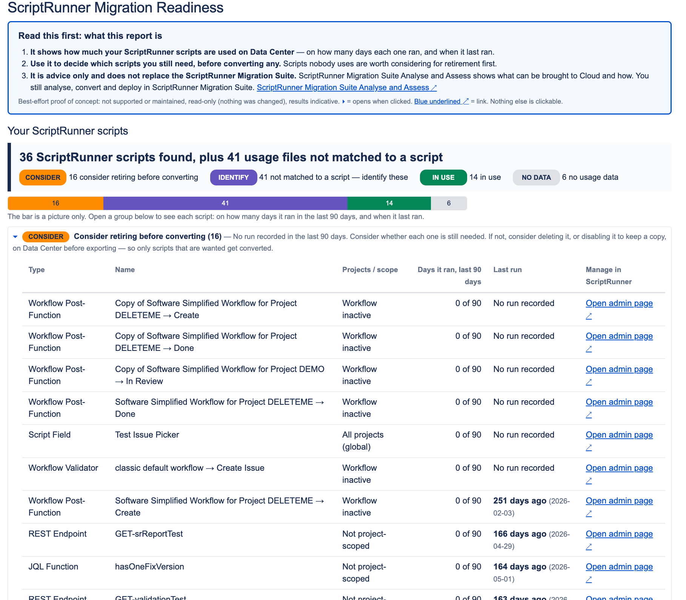

# ScriptRunner for Jira: Data Center to Cloud readiness

> **Best-effort proof of concept.** Not supported, not maintained, not an official Adaptavist or Atlassian tool. Read-only. Results are indicative: verify before acting.

> **For a real analysis of your instance, use the [ScriptRunner Migration Suite](https://docs.adaptavist.com/sms/latest).** Its Analyse and Assess tool shows how each script moves to Cloud; its Migration Agent converts them. This report doesn't replace it. It only helps you decide what you might not need to convert at all.

## What it is for

Before converting ScriptRunner scripts to Cloud, find the ones nobody uses, so you can consider retiring them first and convert less.

For each ScriptRunner script on Data Center, the report shows:

- on how many days it ran in the last N days (default 90)
- the date it last ran (UTC)

It shows usage only. It never says whether a script can move to Cloud. That is the ScriptRunner Migration Suite's job.

## Where it fits

1. Run this report and review the "Consider retiring" list with script owners.
2. Delete or disable scripts that are no longer needed.
3. Script Registry export ("Export active scripts only").
4. [ScriptRunner Migration Suite Analyse and Assess](https://docs.adaptavist.com/sms/latest/scriptrunner-migration-suite-web-app/scriptrunner-migration-analyse-and-assess-tool) (always do this).
5. Convert with the [ScriptRunner Migration Suite Migration Agent](https://docs.adaptavist.com/sms/latest/scriptrunner-migration-suite-web-app/scriptrunner-migration-agent), deploy with the [Dev and Deployment Tool](https://docs.adaptavist.com/sms/latest/scriptrunner-dev-and-deployment-tool).

Best used before the Script Registry export. Already ran Analyse and Assess? Use both together, then export and analyse again after retiring scripts.

## Before you start

- Jira Data Center with ScriptRunner for Jira installed.
- A Jira administrator who can open the ScriptRunner **Script Console**.
- Tested on Jira 10.3.24 and ScriptRunner 9.30.0, single node. Other versions may work but are untested.
- Try it on a non-production instance first if you can.

**Is it safe?** It only reads. It changes no data or configuration. It makes no network calls, except at Full depth, where it sends app keys to marketplace.atlassian.com to look them up.

## How to run

1. Jira admin → ScriptRunner → **Console**.
2. Paste the whole of [`migration-readiness.groovy`](migration-readiness.groovy) and click **Run**. The options form (below) appears above the script.
3. Choose options, or leave them blank for the defaults (blank = Quick). Click **Run** again.
4. Read the HTML report under the console. Start with "Read this first".

Large instance? First run at Quick with options 5, 6 and 7 ticked (ScriptRunner usage only). Fastest, least chance of a timeout.

### Form options

| # | Option | Default | What it does |
|---|---|---|---|
| 1 | How thorough | Quick | Quick: ScriptRunner usage + Jira counts. Standard: adds user email checks. Full: adds app lookups on the Atlassian Marketplace (needs internet from the Jira server). |
| 2 | Maximum run time (seconds) | 50 | Browsers and proxies often give up after about 60 s. The report stops starting new checks at this limit and lists what it skipped. |
| 3 | Treat a script as unused after (days) | 90 | Window for "days it ran". Widen it (e.g. 365) to catch quarterly or yearly scripts. |
| 4 | Script Listener names | blank | Labels listeners, which ScriptRunner can't list by name. Format: `uuid=Name; uuid=Name`. Find a UUID in ScriptRunner admin → Listeners → Edit → last part of the browser URL. |
| 5 | Leave out: Jira areas that host scripts | included | Workflows, custom fields, projects. |
| 6 | Leave out: wider migration readiness | included | Apps, application links, users, user directories, issue volume, issue security, server timezone. |
| 7 | Leave out: instance inventory | included | System info, groups, issue types, schemes, field configurations, screens (counts only). |

## Reading the report

### ScriptRunner scripts, in groups

| Group | Meaning | What to do |
|---|---|---|
| Consider retiring | No run recorded in the window. | Ask the owner if it's still needed. If not, delete it, or disable it to keep a copy. |
| Identify | Usage files that match no configured script: listeners, other ScriptRunner features, or deleted scripts. Never judged unused. | Name listeners with option 4 and re-run. Look up the rest before deciding anything. |
| In use | Ran at least once in the window. | Keep. Analyse and Assess decides how it moves. |
| No usage data | A type ScriptRunner doesn't record usage for (e.g. Behaviours), or a workflow condition with no recorded run. Unknown, not zero. | Check with the owner. |
| Not read | Usage couldn't be read (e.g. time limit hit). Unknown, not zero. | Raise option 2 and re-run. |

Each row has a link to manage that script in ScriptRunner admin.

**Copy the full list into a spreadsheet:** open that section, select all in the box, copy, paste into Excel or Google Sheets. It lands in columns, so you can add an owner and a decision per script.

### Other sections

- **Wider Jira migration readiness:** Jira areas that affect the overall migration plan (apps, application links, users, directories, issue security). Each line is marked Review, Plan, OK or Info.
- **Instance inventory:** counts for a complete record of the instance.
- **About this run:** settings used and how long it took.

## What's covered

| Feature type | Usage shown? |
|---|---|
| Scheduled Jobs, Escalation Services | Yes |
| Workflow Post-Functions, Validators | Yes |
| Script Fields | Yes |
| REST Endpoints, JQL Functions | Yes, once called at least once |
| Script Listeners | Yes, under "Identify" unless named with option 4. Listeners that never ran don't appear. |
| Workflow Conditions | Only where ScriptRunner has recorded a run |
| Behaviours | Listed, no usage (ScriptRunner doesn't record it) |
| Script Fragments, Mail Handlers, Resources, built-in scripts | Not included |

## Limits

- No run counts. ScriptRunner's stored data can't give an exact number of runs, so the report shows days instead.
- Days and dates are UTC. A run within about 5 minutes of midnight UTC may count on the next day.
- Runs from the last few minutes may not show yet. The ScriptRunner Performance tab is real-time.
- "0 days" isn't proof a script is unneeded. Usage isn't value either: a script that runs once a year can be critical. The owner decides.
- "Projects / scope" is where a script is configured to apply, not which projects triggered it.
- Tested on a single node only. Clusters, large instances and Full depth are untested. Checks you can run yourself: [docs/testing-checklist.md](docs/testing-checklist.md).

How the data is read, and why: [docs/how-it-works.md](docs/how-it-works.md).

## Troubleshooting

| Problem | Fix |
|---|---|
| Page times out, no report | Lower option 2 (e.g. 40) and tick options 5, 6 and 7. |
| Scripts show "Not read" | The time limit was reached. Raise option 2, or tick 5, 6 and 7, and re-run. |
| Many "Identify" rows | Mostly listeners. Name them with option 4. |
| One yellow type-checking hint in the console (`getAllApplicationUsers`) | Expected. Doesn't affect the result. |
| "No usage folder found for cluster node(s)" warning | A node in the cluster has no usage files, so nothing is marked unused. Check that node with your Jira administrator; a brand-new node that hasn't run a script yet also causes this. |
| "RRD directory not found" warning | ScriptRunner usage files weren't found, so nothing is marked unused. Check ScriptRunner is installed and has run scripts. |

## Feedback

Found a problem? Open an [issue](../../issues) with your Jira and ScriptRunner versions. Best effort only: no response time is promised.

## Version

1.0.0, tested on Jira 10.3.24 and ScriptRunner 9.30.0, single node. See [CHANGELOG.md](CHANGELOG.md).
